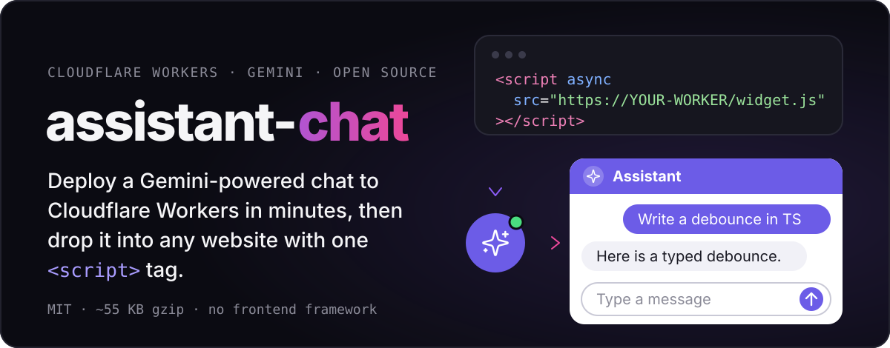
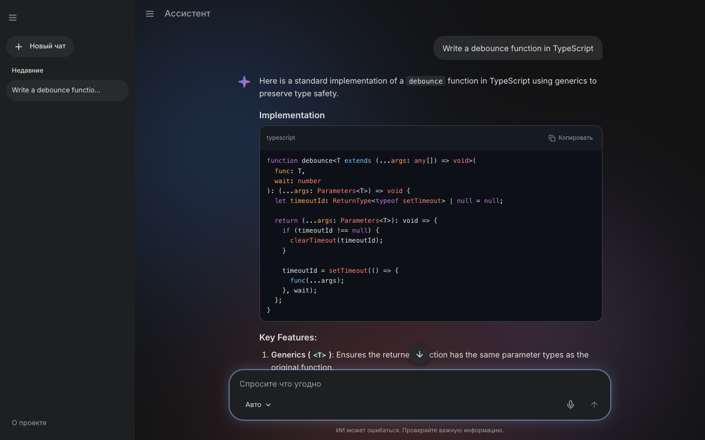
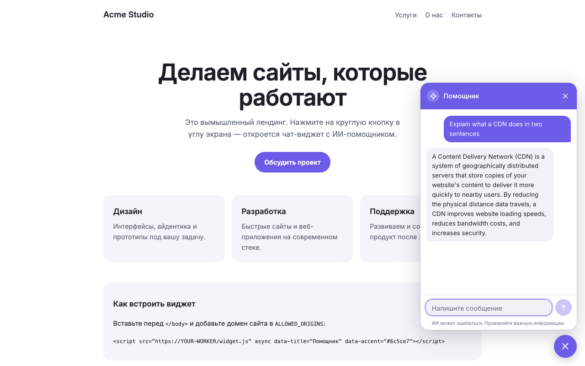
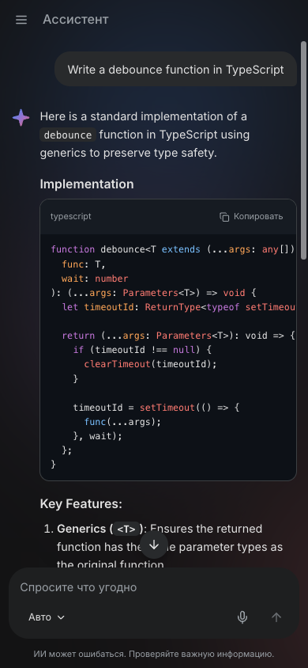
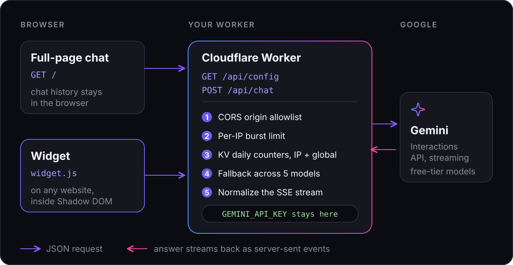

<p align="center">
  
</p>

<p align="center">
  <a href="https://deploy.workers.cloudflare.com/?url=https://github.com/komilovsg/assistant-chat"></a>
</p>

<p align="center">
  <a href="#quick-start">Quick start</a> ·
  <a href="#embed-the-widget">Embed the widget</a> ·
  <a href="#configuration">Configuration</a> ·
  <a href="#api-reference">API</a> ·
  <a href="#limits--notes">Limits</a>
</p>

## See it

<p align="center">
  
</p>

<table>
  <tr>
    <td width="68%" align="center">
      <br>
      <sub>Floating widget on a landing page (<code>/widget-demo.html</code>)</sub>
    </td>
    <td width="32%" align="center">
      <br>
      <sub>Mobile</sub>
    </td>
  </tr>
</table>

All replies above are real Gemini output from this project running locally.

## What it is

A small open-source AI chat that runs entirely on one Cloudflare Worker. You get two things from the same deployment:

- a full-page chat at `/` (streaming replies, Markdown, code highlighting, chat history in the browser);
- an embeddable widget, `/widget.js`, that adds a floating chat button to any website.

It is for web developers who want an AI chatbot on a site or product without running their own backend.

## Why it is different

- **The API key never reaches the browser.** The Worker is a proxy; `GEMINI_API_KEY` is a Worker secret.
- **Built to survive the free tier.** Per-IP burst limit, per-IP daily limit and a global daily cap (KV counters) protect your quota.
- **Automatic model fallback.** In `auto` mode the Worker tries 5 free Gemini models in order and skips ones that are out of quota for the day.
- **Widget in a Shadow DOM.** No CSS clashes with the host page; styles are applied through a constructed stylesheet, so a strict host CSP does not break it.
- **Strict CSP** on the app itself: no `unsafe-inline`, no inline scripts or styles.
- **Nothing is stored on the server.** Chat history lives in the browser; messages are not logged.
- **No frontend framework.** TypeScript and esbuild; the widget is about 55 KB gzip (markdown renderer and code highlighter included).

## How it works

<p align="center">
  
</p>

1. The browser sends the conversation to `POST /api/chat` (at most 40 messages; the Worker keeps the last 12, about 20k characters).
2. The Worker checks the origin, the burst limit and the daily counters, then calls the Gemini Interactions API with `stream: true`, starting with the first model in the list.
3. If a model is unavailable, out of daily quota or silent for 25 s, the next one is tried.
4. Gemini's stream is rewritten into a small, stable SSE protocol (`meta`, `delta`, `error`, `done`) so the client does not depend on upstream event names.

## Quick start

### Deploy to Cloudflare

1. Click **Deploy to Cloudflare** above. Cloudflare copies the repo to your account and builds the frontend. The `LIMITS` KV binding has no `id` in `wrangler.jsonc`, so Wrangler's automatic provisioning creates the namespace on deploy.
2. Add your `GEMINI_API_KEY` ([get one in Google AI Studio](https://aistudio.google.com/apikey)) as a Worker secret. If the setup page does not ask for it, run `npx wrangler secret put GEMINI_API_KEY` or add it in the dashboard under Workers, Settings, Variables and Secrets.
3. Open `https://assistant-chat.<your-subdomain>.workers.dev`.

### Or by hand

```sh
npx wrangler login
npx wrangler secret put GEMINI_API_KEY   # paste the key when prompted
npm run deploy                           # builds, creates the KV namespace on first run, deploys
```

### Run locally

```sh
git clone https://github.com/komilovsg/assistant-chat.git
cd assistant-chat
npm install
cp .dev.vars.example .dev.vars   # put GEMINI_API_KEY=... inside (git-ignored)
npm run dev                      # http://localhost:8787
```

Local runs use a simulated KV and rate limiter; nothing is created in your Cloudflare account. Try the widget at `http://localhost:8787/widget-demo.html`.

## Embed the widget

Add this before `</body>` on any site:

```html
<script src="https://YOUR-WORKER/widget.js" async data-title="Assistant" data-lang="en"></script>
```

Then allow that site in `ALLOWED_ORIGINS` (see [Configuration](#configuration)); by default the API only answers requests from its own origin.

| Attribute | Default | Meaning |
| --- | --- | --- |
| `data-title` | `Assistant` / `Помощник` | Panel title |
| `data-lang` | `ru` | UI language: `ru` or `en` |
| `data-accent` | `#6c5ce7` | Accent color, hex (`#rgb` to `#rrggbbaa`) |
| `data-position` | `right` | Launcher side: `right` or `left` |
| `data-greeting` | server `GREETING` | First message shown in an empty chat |
| `data-open` | `false` | `true` opens the panel on load |

Control it from your own code:

```js
window.AssistantChat.open();
window.AssistantChat.close();
window.AssistantChat.toggle();
```

The API is available right after the script tag is parsed, even before the widget finishes mounting. The widget keeps its conversation in `sessionStorage` (last 40 messages).

> [!WARNING]
> `ALLOWED_ORIGINS="*"` lets **any** website embed your widget and spend **your** Gemini quota. Per-IP limits still apply, but the global daily cap is shared by everyone. Prefer an explicit list such as `https://shop.example.com,https://blog.example.org`. The Origin check only stops browsers; the IP and global limits are what stop scripts that forge it.

## Configuration

Set variables in `wrangler.jsonc` under `vars` (or in the Cloudflare dashboard). The key goes in a secret, locally in `.dev.vars`.

| Name | Type | Default | Meaning |
| --- | --- | --- | --- |
| `GEMINI_API_KEY` | secret, required | none | Google AI Studio key |
| `APP_NAME` | var | `Ассистент` | Name in the header, page title and system prompt |
| `GREETING` | var | `Привет! Чем могу помочь?` | Greeting for an empty chat |
| `SYSTEM_PROMPT` | var, optional | built-in general assistant prompt (Russian, replies in the user's language) | Replaces the system prompt |
| `ALLOWED_ORIGINS` | var | `""` (same origin only) | Comma list of exact origins, or `*` |
| `DAILY_IP_LIMIT` | var | `30` | Chat requests per IP per day |
| `DAILY_GLOBAL_LIMIT` | var | `400` | Chat requests per day for everyone |

Other settings:

- **Burst limit:** `ratelimits` in `wrangler.jsonc` (default 5 requests per 60 s per IP; the period must be 10 or 60).
- **Models and fallback order:** `MODELS` in `src/server/config.ts`.
- **Limits on size:** `MAX_BODY`, `MAX_MSGS`, `MAX_LAST`, `KEEP_MSGS` in the same file.
- **Daily reset:** counters use the Pacific day, which is when Google's quotas reset.
- **Custom domain:** add `"routes": [{ "pattern": "chat.example.com", "custom_domain": true }]` to `wrangler.jsonc` (the zone must be on Cloudflare).

## API reference

### `GET /api/config`

Public, cached for 5 minutes.

```json
{
  "appName": "Ассистент",
  "greeting": "Привет! Чем могу помочь?",
  "models": [{ "id": "gemini-3-flash-preview", "label": "Gemini 3 Flash (preview)" }],
  "maxInputChars": 4000
}
```

`models` is the fallback order used by `auto`.

### `POST /api/chat`

```json
{
  "model": "auto",
  "messages": [
    { "role": "user", "text": "Write a debounce function in TypeScript" }
  ]
}
```

`model` is `auto` or an id from `/api/config`. `messages`: 1 to 40 items, the last one from `user` (up to `maxInputChars`), body up to 32 KB.

The response is `text/event-stream` with an `X-Remaining-Today` header (requests left for this IP). Each event is one `data: <json>` line:

| Event | Meaning |
| --- | --- |
| `{"type":"meta","model":"..."}` | Once, first: the model that answered |
| `{"type":"delta","text":"..."}` | Zero or more: append text in order |
| `{"type":"error","message":"..."}` | At most once: upstream broke mid-answer |
| `{"type":"done","status":"completed"\|"incomplete"}` | Once, last. `incomplete` = answer was cut |

Errors before streaming return JSON `{ "error", "message", "retryAfter"? }`. Error messages are in Russian.

| Status | `error` | When |
| --- | --- | --- |
| 400 | `bad_request`, `invalid_model` | Malformed body, unknown model |
| 403 | `forbidden_origin` | Origin not in `ALLOWED_ORIGINS` |
| 405 | `method_not_allowed` | Wrong HTTP method |
| 413 | `too_large` | Body over 32 KB |
| 415 | `unsupported_media_type` | Not `application/json` |
| 429 | `rate_limited` | Per-IP burst limit |
| 429 | `daily_ip`, `daily_global` | Daily limits (`Retry-After` is set) |
| 500 | `config` | Server misconfigured, e.g. invalid key |
| 503 | `unavailable` | All models failed |

The full protocol is documented at the top of [`src/worker.ts`](./src/worker.ts).

## Project structure

```text
src/
  worker.ts        Worker entry: routing, limits, SSE response
  server/          config (models, limits), gemini client, http (CSP, CORS), limits (KV), validate
  client/          full-page chat (main.ts, store.ts)
  widget/          embeddable widget (index.ts, widget.css)
  shared/          code shared by both UIs: api, markdown, icons, typewriter, scroll
public/            static files; app.js and widget.js are build output
test/              vitest
build.mjs          esbuild bundling
wrangler.jsonc     bindings, limits, vars
```

## Scripts

| Command | What it does |
| --- | --- |
| `npm run dev` | Build, then `wrangler dev` |
| `npm run build` | Bundle `public/app.js` and `public/widget.js` |
| `npm run build:watch` | Rebuild on change |
| `npm run deploy` | Build and `wrangler deploy` |
| `npm run typecheck` | TypeScript check for worker and frontend |
| `npm test` | Run tests (vitest) |

## Limits & notes

- **Free-tier quotas vary** by model and change over time; check your limits at [aistudio.google.com/rate-limit](https://aistudio.google.com/rate-limit).
- **KV free plan allows about 1000 writes per day.** Each chat request writes 2 keys, which is roughly 480 chats a day after overhead, so the default `DAILY_GLOBAL_LIMIT` of 400 fits. Counters are eventually consistent and may overshoot slightly.
- Answers are capped at 1024 output tokens.
- Gemini is a trademark of Google LLC. This project is not affiliated with or endorsed by Google.

## 🇷🇺 Кратко по-русски

- Открытый ИИ-чат на одном Cloudflare Worker: полноэкранный чат на `/` и виджет `/widget.js` для любого сайта.
- Ключ Gemini хранится только в секрете Worker и не попадает в браузер.
- Лимиты на IP и общий дневной лимит защищают бесплатную квоту; 5 моделей Gemini подключаются по очереди.
- Установка: кнопка Deploy to Cloudflare или `npm install`, `.dev.vars`, `npm run dev`.
- Встраивание: один тег `<script src=".../widget.js">`, домен сайта нужно добавить в `ALLOWED_ORIGINS`.

## License

[MIT](./LICENSE) © 2026 komilovsg
